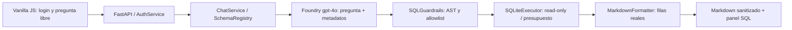

# Evidencia técnica — EISA RRHH NL2SQL

Verificado el **23 de octubre de 2026**. Prototipo académico de la tesis de
Freinny Moreno. Todos los registros, personas, obras y costos son sintéticos.

**URL HTTPS:** https://aca-eisa-rrhh-demo.happybeach-228ed8be.eastus.azurecontainerapps.io

Usuario seeded: `freinny_moreno@eisa.cl`. La contraseña fue la indicada por el usuario
en la sesión; no se reproduce en documentación, código, imagen, fixtures ni Git.
El backend recibe únicamente su hash bcrypt mediante Container App Secret.

## Destino autorizado y aislamiento

El blueprint completo se leyó desde el ZIP suministrado. Su destino inicial,
`AP Global Sandbox`, no apareció en la lista refrescada de Azure CLI. Se inició
login por dispositivo con la cuenta solicitada. El usuario autorizó expresamente
usar **Azure CL - Credit Card - Presales (Franky Rojas)** y después reutilizar el
mismo deployment Foundry que Amalia. La suscripción efectiva se confirmó:

- ID: `6c51ac27-9d90-4bde-94e5-511ca2fa75d2`.
- Tenant: `5434c158-104d-4cb4-ab65-db5e86b27e6b`.
- Ubicación: `eastus`.
- Base Git: `main`, commit `257108bf2f595279d32d3528ecba4015d4499dad`.
- Rama: `feature/eisa-rrhh-nl2sql-foundry`.

Se trabajó en una copia Git aislada porque el `.git` del workspace es de solo
lectura. Se hizo fetch/pull de `main` y se comprobó que la rama no existiera.
El código también está disponible en el workspace original como archivos nuevos.
No se alteraron `apps/api`, `apps/web`, `packages`, npm workspaces, secretos ni
configuración de Amalia/Cinépolis. El acceso a su modelo fue de lectura/inferencia.

## Recursos creados

| Recurso | Nombre | Uso |
|---|---|---|
| Resource group | `rg-eisa-rrhh-demo-20261023` | Aislamiento completo del prototipo |
| ACR Basic | `acreisarrhh20261023` | Build remoto e imagen de EISA |
| Managed Environment | `acae-eisa-rrhh-demo` | Entorno dedicado, sin Log Analytics |
| Container App | `aca-eisa-rrhh-demo` | Una réplica, 0.5 vCPU, 1 GiB, HTTPS |
| User-assigned identity | `id-eisa-rrhh-demo` | Identidad dedicada adjunta, sin roles nuevos en recursos compartidos |

Todos llevan `purpose=academic-demo`, `owner=freinny`, `data=synthetic`,
`application=eisa-rrhh-demo`. No se borró ni sustituyó ningún recurso existente.

Revisión lista: **`aca-eisa-rrhh-demo--9oka1dd`**. Réplica observada en estado
`Running`, contenedor `ready=true`, `started=true`. Mínimo=máximo=1.
Imagen desplegada por digest:
`sha256:56315ec3a810316f9c6628bc585383942002b7756917981c404528d8a4fea705`.
El build remoto ACR `ca2` terminó correctamente con Docker multistage y usuario
no-root. Seed generado durante el build; SQLite de solo lectura en runtime.

**Foundry reutilizado, no creado/modificado:**
`aires-amalia-demo-001-resource`, grupo `rg-amalia-demo-001`, deployment real
**`gpt-4o`** (`2024-11-20`). Su configuración se leyó de la Container App de Amalia.
Endpoint v1 verificado por una inferencia real:
`https://aires-amalia-demo-001-resource.openai.azure.com/openai/v1/`.

La inferencia mediante token Entra devolvió HTTP 401. La clave autorizada funciona
y se transportó solo en memoria, por HTTPS, a `foundry-key` en la nueva Container
App. Se configuraron también secretos para el hash bcrypt y la firma de sesión.
El rol efectivo Contributor impidió asignar AcrPull; se utilizó la credencial del
**ACR exclusivo de EISA**, almacenada en `acr-pull-password`. No se modificó RBAC
de Amalia ni de recursos compartidos. El script permite reanudar únicamente un
grupo cuyos recursos mantienen las cuatro etiquetas exactas de propiedad EISA.

## Arquitectura y responsabilidades

Python implementa OOP, sesiones, contexto temporal, catálogo de cuatro vistas,
cliente OpenAI SDK, validación AST, authorizer SQLite, límites, formato y trazas.
SQL define los indicadores agregados; Foundry genera SQL dinámico sin conexión
ni credenciales de BD. Azure hospeda el contenedor y sus secretos. El frontend
nunca recibe claves y no puede enviar SQL ejecutable.

La UI sigue la referencia visual oficial `ei.cl`, usa su logo azul y el icono
oficial de Microsoft Fabric. Contiene **una sola pregunta sugerida**. El identificador
`9404chaj34030` suministrado por el usuario aparece como referencia de arquitectura;
no hay conexión verificada al workspace de Fabric. Las consultas efectivas usan
SQLite3 y la interfaz conserva el aviso académico de datos sintéticos. El panel
SQL dedicado se actualiza únicamente tras validar y ejecutar cada consulta.

## Aceptación con Foundry real por HTTPS

El [smoke completo](eisa-rrhh-demo/acceptance.json) contiene las siete preguntas,
SQL generado, columnas, filas, trazas y latencias. No envía SQL al API ni reemplaza
inferencias por fixtures. Compara filas y nombres de columnas, sin depender de
la prosa del modelo. Cada pregunta fue repetida además en el navegador público,
escrita en el campo libre: [evidencia de navegador](eisa-rrhh-demo/public-browser.json).

| Pregunta | Resultado real verificado | Vista Gold | Traza del smoke |
|---|---|---|---|
| Colaboradores en septiembre | 22 total, 21 en proyectos, 1 central | `v_gold_resumen_rrhh_mensual` | `c3fac658-9c80-4c37-bf4d-97b21de26f06` |
| Dotación por proyecto en septiembre | Planta Sur 7; Parque Central 7; Logístico Norte 5; Viales Oriente 2; central 1 | `v_gold_personal_proyecto_mensual` | `ffb9be44-f8c1-4386-93fa-cdc3085ab15a` |
| Costo por proyecto en septiembre | CLP 10.900.000; 10.650.000; 8.800.000; 2.350.000; central 1.400.000 | `v_gold_personal_proyecto_mensual` | `dc9e5767-5d73-4d4e-a0f8-362cd569b92a` |
| Dotación por área en septiembre | Operaciones 12; Administración 3; Ingeniería 3; Prevención 3; RRHH 1 | `v_gold_dotacion_area_mensual` | `a5b28e03-311b-4bb5-b7cb-87c88a5e1cb7` |
| Evolución agosto–octubre | 20 / CLP 31.400.000; 22 / 34.100.000; 24 / 37.050.000 | `v_gold_resumen_rrhh_mensual` | `c8df059d-1ee0-4d8c-80cf-183f36a8d62f` |
| Costo total septiembre | CLP 34.100.000 | `v_gold_resumen_rrhh_mensual` | `54a81120-4cf0-4ace-86fb-ef9f7a149ee8` |
| Duración planificada | Parque Central 365 días; Planta Sur 364; Viales 303; Logístico 214, con fechas fin | `v_gold_proyectos` | `e86ad92b-2e65-4f1b-b2dd-f325d2a39a08` |

Las trazas se relacionan con el SQL/filas exportados en el JSON. Cada respuesta
incluye fuente, cantidad de filas, SQL validado y latencia. El formatter usa las
filas de SQLite, no una respuesta numérica redactada por el modelo.

## Pruebas y seguridad

- **56 tests Python** unitarios e integración offline: siete preguntas contra el
  seed, AST, tablas base, DDL/DML, PRAGMA/ATTACH, multi-statement, límites,
  presupuesto de operaciones/tiempo, semántica temporal, auth, revocación, CSRF,
  Host, límites de entrada y errores sin contraseñas.
- Prueba real de Markdown con marked+DOMPurify: conserva tablas/negritas y elimina
  scripts, SVG ejecutable, imágenes con handlers y enlaces `javascript:`.
- Build frontend y Docker multistage correctos; npm audit reportó 0 vulnerabilidades.
- Smoke público: `/healthz` y `/readyz` 200, chat sin sesión 401, login seeded,
  siete respuestas numéricas correctas, logout y replay de cookie invalidado.
- Chromium público: siete preguntas escritas libremente, una sugerencia, SQL visible,
  cero errores JavaScript, viewport móvil de 390 px sin desbordamiento horizontal.
- SQLite abre `mode=ro`, configura `query_only`, authorizer y progress handler;
  solo cuatro vistas, máximo 50 filas, presupuesto 200.000 operaciones / 2 segundos.
- Cookies Secure/HttpOnly/SameSite Strict, Origin exacto, CSP y TrustedHost.

[Resumen verificable](eisa-rrhh-demo/verification.json) ·
[Metadatos del deployment](eisa-rrhh-demo/deployment.json).

Los dos archivos del handoff se conservaron literalmente. SHA-256:

- Seed: `5d1868cb87e6794347058dbdb7f6fedc2500f6780d00a88a7c23f418294533a4`.
- Expected results: `5d009d484713f683f9a046f02e9c9f39c5df20e580e28e7ad8608dedc9754019`.

## Capturas de la aplicación HTTPS real

También se incluyen capturas `public-question-2.png` a `public-question-7.png`.
Estas son capturas reales del navegador en la URL desplegada, no mockups.

## Costos y límites operativos

Consulta de tarifas públicas USD/East US el 23/10/2026 en la
[API oficial Azure Retail Prices](https://prices.azure.com/api/retail/prices),
con copia de medidores en [pricing.json](eisa-rrhh-demo/pricing.json).
A 730 horas/mes, 0.5 vCPU y 1 GiB representan aproximadamente **USD 11,83/mes**
si todo el tiempo fuera idle, o **USD 39,42/mes** si fuera todo active, antes de
franquicias, requests, impuestos y condiciones comerciales. ACR Basic agrega
aproximadamente **USD 5,00 por 30 días**; los builds se cobran por vCPU-segundo.
Son escenarios de cómputo, no una cotización ni el costo completo del entorno.
La [página oficial de Container Apps](https://azure.microsoft.com/en-us/pricing/details/container-apps/)
explica el cargo reducido idle y las franquicias compartidas por suscripción.
No se presupone que Amalia deje esas franquicias disponibles para EISA.

Los tokens se facturan en el deployment compartido de gpt-4o; no se creó otro
modelo. Su costo depende de la oferta y volumen de entrada/salida. No se aprovisionó
Log Analytics; logs técnicos disponibles en consola sin retención duradera. Una
estimación completa debe incluir los medidores del entorno, builds, egress y
consumo real del modelo según Cost Management de la suscripción autorizada.

Una réplica y un worker son deliberados: sesiones y limitadores viven en memoria.
Reiniciar/revisar la app invalida sesiones. No se conectó Fabric productivo ni se
implementaron embeddings/RAG documental. Una migración futura requiere un adaptador
SQL autorizado a Fabric y adaptar el dialecto/guardrails.

## Referencias de implementación

- [OpenAI SDK con endpoint Azure v1 y nombre de deployment](https://learn.microsoft.com/en-us/azure/developer/ai/how-to/switching-endpoints).
- [Referencia gráfica Echeverría Izquierdo](https://ei.cl/).
- [Iconos oficiales de Microsoft Fabric](https://learn.microsoft.com/en-us/fabric/fundamentals/icons).
